---

|   |   |
| --------------------------------------------------------------------------------------------------------------------------------------------------------------------------------------------------------------------------------------------------------------------------------------------------------------------------------------------------------------------- | --------------------------------------------------------------- |
| **Hey 👋! I'm Brook**  I'm an aspiring software developer from Ethiopia 🇪🇹, passionate about technology, coding, and solving real-world problems through creative solutions.  I enjoy building innovative projects, exploring new technologies, and continuously improving my skills.  **Always learning. Always building. Always improving.** 🚀 |  |

---

**📊 GitHub Language Statistics**

  

---

**⚡ Technologies & Tools**

  
  &nbsp;&nbsp;
  
  &nbsp;&nbsp;
  
  &nbsp;&nbsp;
  
  &nbsp;&nbsp;
  
  &nbsp;&nbsp;
  
  &nbsp;&nbsp;
  
  &nbsp;&nbsp;
  
  &nbsp;&nbsp;
  
  &nbsp;&nbsp;
  
  &nbsp;&nbsp;
  
  &nbsp;&nbsp;
  
  &nbsp;&nbsp;
  

---

**🌐 Let's Connect**

  
  &nbsp;
  
  &nbsp;
  
  &nbsp;
  

---

**🐍 Contribution Activity**

  

*Building something meaningful, one commit at a time.* 🚀

**✨ Code. Create. Innovate. Repeat.**

